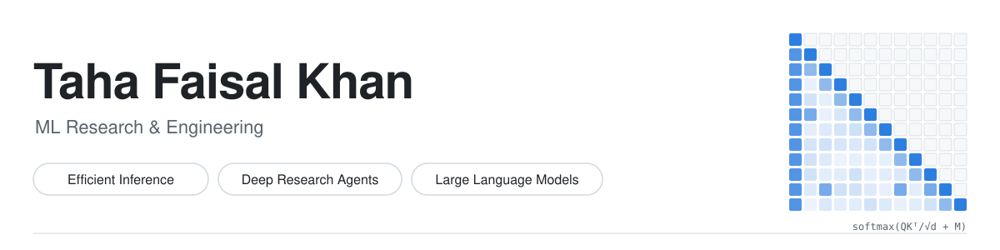

<picture>
  <source media="(prefers-color-scheme: dark)" srcset="assets/header-dark.svg">
  
</picture>

[LinkedIn](https://www.linkedin.com/in/tahafaisalkhan/) · [Email](mailto:tahafaisal999@gmail.com)

**Previous research:** evaluating LLMs reliably in low-resource clinical settings (Urdu): [Toward Reliable Urdu Clinical NLP Benchmarks](https://github.com/tahafaisalkhan/toward-reliable-urdu-clinical-nlp-benchmarks)

- Building transformers and generative models from scratch, and fine-tuning and aligning them (LoRA, DPO)
- Former teaching assistant; I designed course assignments ([taship-assignments](https://github.com/tahafaisalkhan/taship-assignments))
- Open to ML / GenAI research and engineering internships

---

### Generative AI

<table>
  <tr>
    <td width="260"><a href="https://github.com/tahafaisalkhan/toward-reliable-urdu-clinical-nlp-benchmarks"><b>Urdu Clinical NLP Benchmarks</b></a></td>
    <td>Research paper: Urdu translations of ACI-Bench clinical dialogues with Gemma and MedGemma, evaluated by physicians and an LLM-as-a-judge</td>
  </tr>
  <tr>
    <td colspan="2">
      
       Physician evaluation interface: English source dialogue, two model translations, and the clinical rubric.
    </td>
  </tr>
  <tr>
    <td width="260"><a href="https://github.com/tahafaisalkhan/smolLM"><b>SmolLM</b></a></td>
    <td>135M LLaMA-style transformer from scratch (RMSNorm, RoPE, GQA, SwiGLU), LoRA fine-tuning at 0.9% of parameters, then DPO alignment</td>
  </tr>
  <tr>
    <td width="260"><a href="https://github.com/tahafaisalkhan/student-handbook-rag"><b>Handbook RAG</b></a></td>
    <td>Retrieval-augmented QA over a university handbook: LangChain, FAISS, HF embeddings, Mistral via Ollama</td>
  </tr>
</table>

### Machine Learning

<table>
  <tr>
    <td width="260"><a href="https://github.com/tahafaisalkhan/ml-news-classification"><b>Urdu News Classification</b></a></td>
    <td>Scraped Urdu news corpus, preprocessing, EDA and custom classifiers across five categories</td>
  </tr>
  <tr>
    <td width="260"><a href="https://github.com/tahafaisalkhan/lung-cancer-prediction-model"><b>Lung Cancer Severity</b></a></td>
    <td>Severity prediction with preprocessing, EDA and a comparison of ML models</td>
  </tr>
  <tr>
    <td width="260"><a href="https://github.com/tahafaisalkhan/k-nearest-neighbours"><b>K-Nearest Neighbours</b></a></td>
    <td>KNN and radius-NN from scratch in NumPy, with cross-validation and benchmarking against scikit-learn on MNIST and Breast Cancer</td>
  </tr>
  <tr>
    <td width="260"><a href="https://github.com/tahafaisalkhan/naive-bayes"><b>Naive Bayes</b></a></td>
    <td>Bernoulli and Multinomial Naive Bayes from scratch on Golf and TweetEval</td>
  </tr>
</table>

### Deep Learning

<table>
  <tr>
    <td width="260"><a href="https://github.com/tahafaisalkhan/clip-model"><b>CLIP</b></a></td>
    <td>Contrastive image–text model (ResNet + DistilBERT) trained in a shared embedding space, with zero-shot classification from text prompts</td>
  </tr>
  <tr>
    <td width="260"><a href="https://github.com/tahafaisalkhan/stable-diffusion"><b>Diffusion Models</b></a></td>
    <td>DDPM from scratch (unconditional, class-conditional, CLIP-guided) plus Stable Diffusion inpainting and ControlNet style transfer</td>
  </tr>
  <tr>
    <td width="260"><a href="https://github.com/tahafaisalkhan/pixel-cnn"><b>PixelCNN</b></a></td>
    <td>Autoregressive image model with masked convolutions and residual blocks</td>
  </tr>
  <tr>
    <td width="260"><a href="https://github.com/tahafaisalkhan/gan-interpolation"><b>GAN Latent Space</b></a></td>
    <td>Latent interpolation and vector arithmetic on MNIST and CelebA generators</td>
  </tr>
  <tr>
    <td width="260"><a href="https://github.com/tahafaisalkhan/brain-tumour-segmentation"><b>Brain Tumour Segmentation</b></a></td>
    <td>MRI segmentation with a custom autoencoder (Dice 0.64)</td>
  </tr>
  <tr>
    <td width="260"><a href="https://github.com/tahafaisalkhan/spectralGNN"><b>Graph Neural Networks</b></a></td>
    <td>Spectral GCN with Laplacian regularization (MUTAG), a GraphSAGE maze policy compared against Dijkstra, and spatio-temporal traffic forecasting</td>
  </tr>
</table>

### Web Applications

<table>
  <tr>
    <td width="260"><a href="https://github.com/tahafaisalkhan/llm-rating-webapp"><b>LLM Rating Web App</b></a></td>
    <td>Blinded physician evaluation platform for the Urdu clinical NLP study, collecting rubric-based ratings of paired LLM outputs (React, Express, MongoDB)</td>
  </tr>
  <tr>
    <td width="260"><a href="https://github.com/tahafaisalkhan/trading-app"><b>Trading App</b></a></td>
    <td>MERN trading platform with cash and item offers</td>
  </tr>
  <tr>
    <td width="260"><a href="https://github.com/tahafaisalkhan/restaurant-app"><b>Restaurant App</b></a></td>
    <td>MERN restaurant management system for customers and staff</td>
  </tr>
  <tr>
    <td width="260"><a href="https://github.com/tahafaisalkhan/employee-app"><b>Employee App</b></a></td>
    <td>Employee management with Java Servlets, JSP and MySQL</td>
  </tr>
</table>

### Development

<table>
  <tr>
    <td width="260"><a href="https://github.com/tahafaisalkhan/campus-management-android-app"><b>Campus Events</b></a></td>
    <td>Android app for publishing and managing university events, with Firebase auth, role-based admin workflows, digital tickets and QR check-in</td>
  </tr>
  <tr>
    <td width="260"><a href="https://github.com/tahafaisalkhan/emotilog-android-app"><b>EmotiLog</b></a></td>
    <td>Android mood-tracking app in Java</td>
  </tr>
  <tr>
    <td width="260"><a href="https://github.com/tahafaisalkhan/chrono-savior"><b>Chrono Savior</b></a></td>
    <td>Single-player action-adventure game in Unity / C#</td>
  </tr>
</table>

---

### Stack

**Programming languages:** Python · C++ · C · CUDA · TypeScript · JavaScript · SQL · Java · C# · HTML · LaTeX

**Libraries:** PyTorch · Hugging Face · NumPy · pandas · Matplotlib · scikit-learn · Flask · Seaborn · Socket.io · LangChain

**Frameworks & tools:** React · Express · MongoDB · Git · Docker
